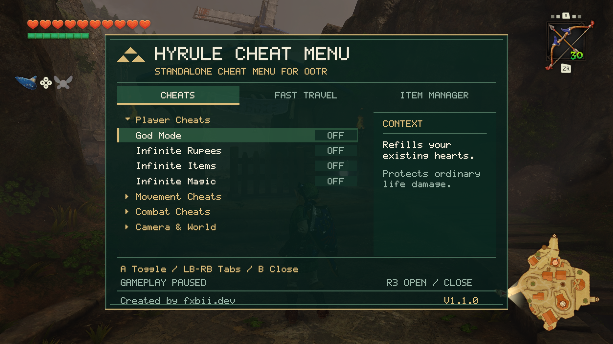
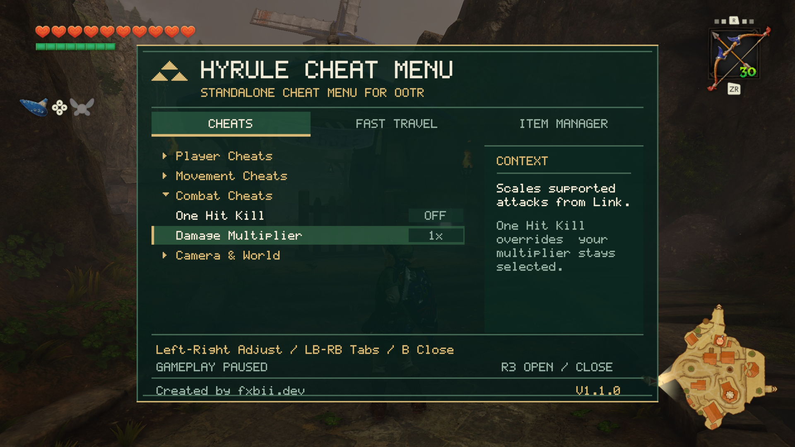
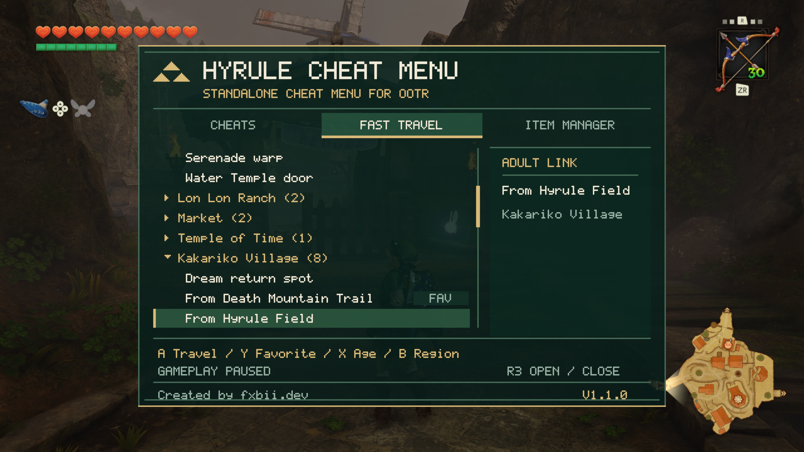
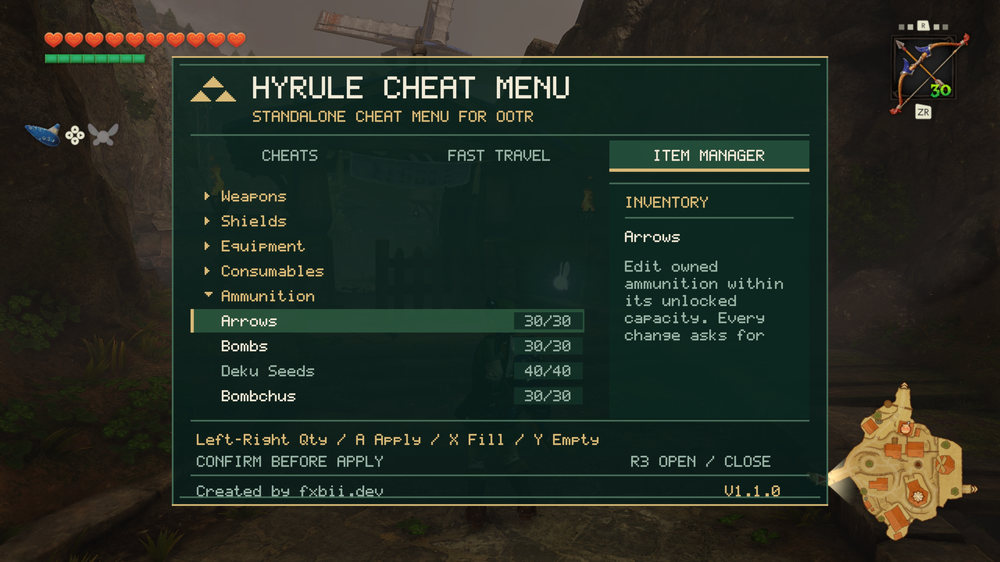
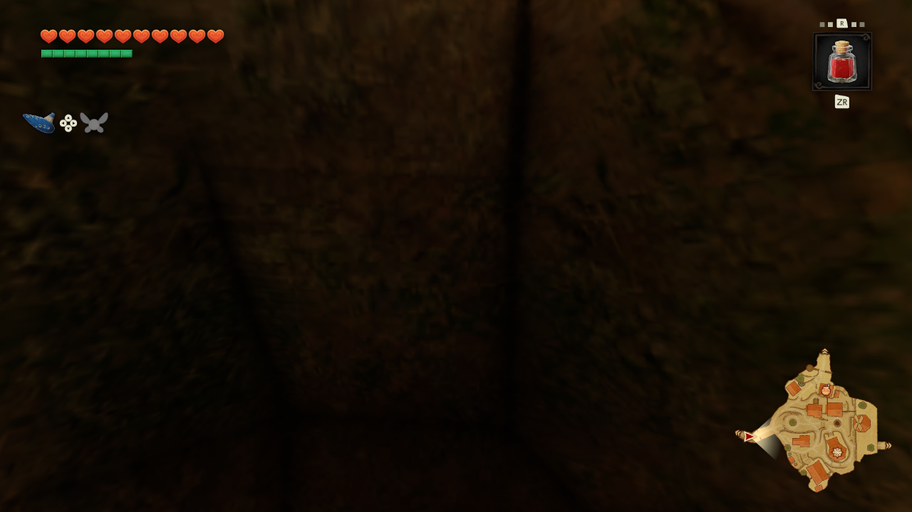
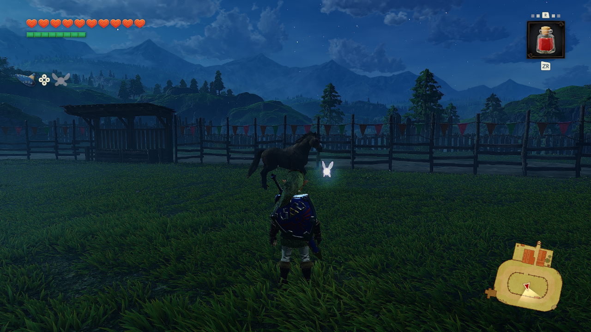
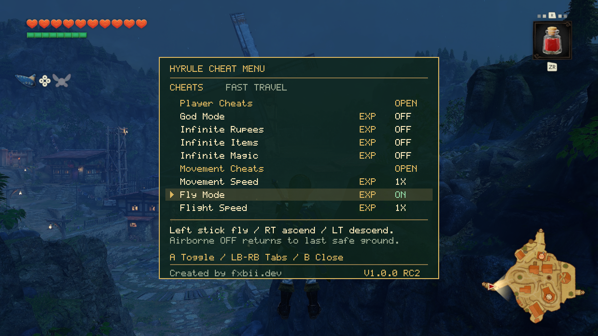
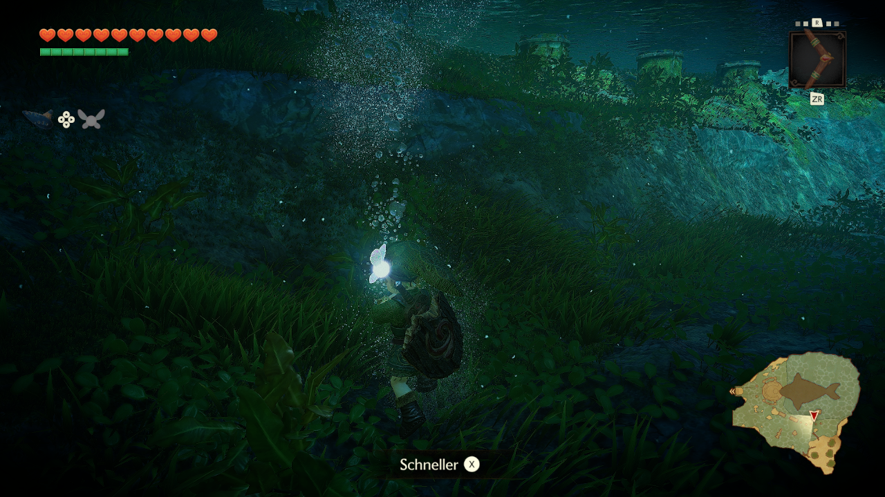

> **v1.1.3** · [Releases](https://github.com/fxbiidev/hyrule-cheat-menu/releases) · [Test report](TEST_REPORT.md) · [Release readiness](RELEASE_READINESS.md)

<div align="center">

# HYRULE CHEAT MENU

**STANDALONE CHEAT MENU FOR OOTR**

`v1.1.3` · `Lichii Build 177` · `Displayed update 2.0.0` · `Windows`

**Created by fxbii.dev**

[Features](#features) · [Installation](#installation) · [Controls](#controls) · [Support](#support--bug-reports)

</div>

Hyrule Cheat Menu runs inside the supported Ocarina of Time remake as an ExeFS add-on. Press **R3** during gameplay to open the menu. Its Emerald & Gold interface has three main tabs: **CHEATS | FAST TRAVEL | ITEM MANAGER**. The game uses its native gameplay pause while the menu is open. The mod adds no persistent HUD, telemetry, updater or external trainer.

The approved design uses deep emerald backgrounds, gold accents, a contextual description card, clear selection and status indicators, comfortable scrolling and adaptive scaling. LB/RB cycles through the tabs in either direction, and each tab remembers its selection and viewport during the session. Cheats are grouped into **Player Cheats**, **Movement Cheats**, **Combat Cheats**, and **Camera & World**. Damage Multiplier sits directly below One Hit Kill. Item Manager has its own tab and five inventory categories.

## Features

| Feature | Behavior |
|---|---|
| God Mode | Restores unlocked hearts and guards the native health decrement while keeping hit reactions. |
| Infinite Rupees | Fills the unlocked wallet and maintains its current capacity. |
| Infinite Items | Refills eligible owned arrows, bombs, Bombchus and Deku ammunition; guards ordinary single-ammo use with age and capacity checks. Excludes bottles, beans, keys and quest items. |
| Infinite Magic | Refills an existing meter. Unavailable before magic is unlocked. |
| Movement Speed | 1× / 1.5× / 2× / 3× for ordinary walking, running, swimming and climbing requests. |
| Fly Mode | Camera-relative horizontal movement, vertical controls and hovering through Link's native collision controller. |
| Flight Speed | Independent 1× / 1.5× / 2× / 3× / 5× / 10× setting. |
| Noclip | Grounded wall bypass with native floor support; combine with Fly for walls, floors and ceilings. Conservative safe-position recovery. |
| One Hit Kill | Conservative ordinary-enemy allowlist and checked player-originated damage. Verified Master Sword and Fairy Bow path; see the combat scope below. |
| Damage Multiplier | 1× / 1.5× / 2× / 3× outgoing damage on the supported combat path. One Hit Kill takes priority while the selected multiplier stays stored. |
| Free Camera | Detach the gameplay view, translate/rotate with both sticks and ascend/descend with the triggers. Includes direct emergency exit and native restoration. |
| Item Manager | Confirmed add/remove ownership for 21 native item IDs, including unowned gear; quantity controls for seven consumable/ammunition stacks. Age, capacity and shared-slot safeguards apply. |
| Fast Travel | All 214 reference destinations in 37 collapsible groups, including dungeon subgroups, age selection, confirmation, Favorites and Return. |

Unavailable controls remain readable with contextual explanations. Each toggle is independent; normal and flight speeds remain separate. Native gameplay results, host fixtures and older-version evidence retain their exact binary scope in [TEST_REPORT.md](TEST_REPORT.md).

## Screenshots

These historical in-game captures show the approved v1.1.0 design, three tabs and uppercase subtitle. The v1.1.1 Item Manager adds ownership editing to this layout; these older captures do not demonstrate the patch. The [v1.1.1 native evidence](docs/v1.1.1-native-results.json) records the patch ownership/save tests; [v1.1.0 evidence](docs/v1.1.0-native-results.json) retains those older captures' binary scope; the [design review](docs/v1.1.0-design-review.md) retains the earlier approval captures.

<p align="center">
  
  
  
  
</p>

<details>
<summary>Historical v1.0.0 landing, movement and pause captures</summary>











These captures retain their original v1.0.0/RC binary provenance. They are not new v1.1.0 acceptance results. Screenshots demonstrate only the pictured state; the test report records exact coverage.

</details>

## Compatibility

| Component | Target |
|---|---|
| Current emulator target | Lichii Build 177 on Windows |
| Current library update label | 2.0.0 |
| Title ID | `0400486024DEC000` |
| Main Build ID | `E0F3CCFAF50065AE4EA01EB5AEB13B1A45DA3348` |
| Pinned compressed main SHA-256 | `7db9ddfda088c22d219ef13496decd7077c68cd67d4b37f53f4ac46a082768f2` |

The owner's current game container displays update **2.0.0**, but its title1 main executable is byte-identical to the private executable used for the earlier 1.1.1-profile testing. Its Build ID is unchanged, so this exact executable needs no hook-address port. This is an identity check, not a claim that every update labelled 2.0.0 is compatible or that all gameplay tests have been rerun on Build 177. Earlier gameplay evidence used Build 130; consult the current test report for subsequent results.

The IPS filename gates loading by Build ID. Runtime title/layout and function signatures guard activation, with feature-specific failures. Other executables, regions, forks, and arbitrary hook mods are unverified. An existing mod using `subsdk8` conflicts with this installation. Historical built-in FPS Unlock and Dynamic FPS checks do not establish universal mod compatibility.

## Installation

1. Close the game. Back up your saves using the procedure below.
2. In Lichii, right-click the supported game and choose **Open Mod Data Location**.
3. Extract `Hyrule-Cheat-Menu-v1.1.3.zip` there. Replace the complete mod folder when updating, including both ExeFS files. The result must be:

```text
<game's mod data location>/
└── Hyrule-Cheat-Menu/
    ├── exefs/
    │   ├── subsdk8
    │   └── E0F3CCFAF50065AE4EA01EB5AEB13B1A45DA3348.ips
    ├── third_party/
    │   └── Fast-Travel-LICENSE.txt
    └── README.md
```

4. Enable the add-on in the game's properties if necessary, start the game, and load a save.
5. During ordinary gameplay, press **R3**. No separate executable or runtime service is required.

Avoid an extra nested `Hyrule-Cheat-Menu/Hyrule-Cheat-Menu` folder. Disable a separate Fast Travel overlay during integrated-travel testing so its controls cannot interfere.

The optional `Hyrule-Cheat-Menu-v1.1.3-source.zip` is the review/build source archive. Install the add-on ZIP above. Its sibling `.sha256` file records the exact archive checksum.

### Updates and removal

Close the game and replace the installed `Hyrule-Cheat-Menu` folder. Preferences live separately on the emulator's SD card and survive replacement. Remove that mod folder to uninstall; base game files are not patched on disk. Optionally remove `sdmc/Hyrule-Cheat-Menu/` under Lichii's user directory to erase preferences as well.

## Controls

Labels refer to logical game inputs after Lichii's configured controller mapping; physical button labels can differ.

| Input | Action |
|---|---|
| R3 | Open / close; reverses the current menu transition |
| D-pad Up / Down | Select; wraps and repeats when held |
| A / confirm | Toggle, expand, select or confirm |
| B / back | Cancel confirmation; collapse a travel/item category or its parent; close from a collapsed root header |
| D-pad Left / Right | Adjust speed or damage once per press; open/collapse category headers; draft an editable item quantity |
| LB / RB | Previous / next tab: CHEATS, FAST TRAVEL, ITEM MANAGER; wraps at either end |
| X on Fast Travel | Select Young / Adult destination list |
| Y on a travel destination | Add / remove Favorite |
| A on an editable item | ADD ITEM / REMOVE ITEM; if a quantity is drafted, confirm that quantity. A separate A applies the change |
| X on an editable item | Open a refill-to-capacity confirmation |
| Y on an editable item | Open a remove-item / zero-stock confirmation |
| Left stick while flying | Horizontal flight relative to the camera |
| Right stick while flying | Normal camera controls |
| Left stick in Free Camera | Move the camera |
| Right stick in Free Camera | Rotate the camera |
| RT / logical ZR | Ascend in Fly Mode or Free Camera |
| LT / logical ZL | Descend in Fly Mode or Free Camera |
| R3 + B in Free Camera | Emergency camera exit, including with the main menu closed |

The mod reads Player 1 with handheld fallback. Menu navigation inputs are consumed while it is open. Tabs and confirmation actions respond once per press; holding A does not submit a second confirmation. Physical Xbox, PlayStation and Nintendo controller acceptance is separate from logical-input tests.

## Combat Cheats

The implemented policy limits **One Hit Kill** and **Damage Multiplier** to these eight exact ordinary-enemy variants: Red/Blue Tektites; ordinary/Fire/Ice Keese; ordinary/large Stalchildren; and Octoroks. The native attacker must resolve to the current Link through a checked game handle. Link, friendly NPCs, unrelated sources, bosses, minibosses and every unlisted target retain native damage handling. Stalfos, Gold Skulltulas and invisible Keese are excluded.

Damage settings are **1×, 1.5×, 2× and 3×**. Fractional half points round upward consistently, so 3 damage at 1.5× becomes 5. One Hit Kill has priority while enabled; the selected multiplier stays stored and resumes when One Hit Kill is disabled. With One Hit Kill OFF, 1× is ordinary damage. Native caps, invulnerability, scripted phases and death/reward handling remain in the game.

Native Master Sword and Fairy Bow checks against Red/Blue Tektites pass for all four damage settings, One Hit Kill priority and immediate multiplier resumption. Received damage remains unchanged. Native tests cover those encounters; host fixtures cover every allowlisted name, unsafe target/source refusals, rounding and caps. See [combat verification](docs/combat-verification.md), [TEST_REPORT.md](TEST_REPORT.md) and [release readiness](RELEASE_READINESS.md) for exact scope. Broader enemy support requires new evidence.

## Free Camera

Enable **Free Camera** under **Camera & World**, then close the menu. The left stick moves the camera; the right stick rotates it; RT rises and LT descends. Opening the main menu freezes camera movement. Disable the toggle to restore the native view, or press **R3 + B** for direct emergency exit while the menu is closed.

**The world continues to run.** Free Camera does not move Link or grant damage immunity. Gravity, enemies and platforms remain active; God Mode, Fly and Noclip keep their own policies. With Fly selected, camera controls do not become flight inputs. After camera exit, held controls stay drained until the exit combination and movement controls are released to neutral; normal control then resumes.

Unsafe world/scene changes, Fast Travel, normal save loading, incompatible cutscenes, a missing controller or invalid camera ownership stop the camera. It requires explicit reactivation after an interruption. Native restoration and controller handoffs are checked independently of the menu's appearance. See [Free Camera verification](docs/free-camera-verification.md) for exact completed native and fixture coverage.

## Item Manager

Open **ITEM MANAGER** with LB/RB. The closed catalog uses **21 real native item IDs**, with OWNED / NOT OWNED status and **ADD ITEM / REMOVE ITEM** actions. Grants change ordinary game inventory; prior gameplay acquisition is not required.

| Category | Items | Operations |
|---|---|---|
| Weapons | Kokiri Sword, Fairy Bow, Fairy Slingshot, Boomerang, Hookshot, Longshot, Megaton Hammer | Add / remove ownership |
| Shields | Deku Shield, Hylian Shield, Mirror Shield | Add / remove ownership |
| Equipment | Goron Tunic, Zora Tunic, Iron Boots, Hover Boots | Add / remove ownership |
| Consumables | Deku Sticks, Deku Nuts, Magic Beans | Add / remove stock; adjust quantity |
| Ammunition | Arrows, Bombs, Deku Seeds, Bombchus | Add / remove stock; adjust quantity |

**A** prepares ADD ITEM for an absent item or REMOVE ITEM for an owned item. A separate **A** confirms; **B** cancels. For stacks, Left/Right drafts a quantity, **A** prepares that quantity, **X** prepares refill and **Y** prepares zero stock. Drafting/cancelling never writes inventory. A normal game save persists confirmed changes.

Edits respect Link's current age and the game's real capacity. Use Adult Link for adult equipment/arrows and Young Link for child equipment/seeds/sticks/beans. Hookshot and Longshot share a slot: remove the other variant first. Add the Bow/Slingshot before adding their ammunition; empty arrows/seeds before removing that tool. Equipment removal uses native equipment/quickslot cleanup. Removing ammunition empties stock while preserving its tool and bag; the stock game may still show the owned tool with zero ammunition. Magic Beans use the game's native inventory item and capacity of 10; prior purchase is not required. Bean purchase progression and planted locations are not editable. No quest/trade items, bottles, dungeon keys, progression flags or arbitrary save addresses are editable.

Deku Seeds can be added from zero stock with an owned Fairy Slingshot. If its seed bag has never been initialized, the confirmation explains that the first grant adds the related native 30-seed bag, then sets the requested quantity. Existing 40/50-seed capacities are preserved. Adding seeds does not grant the Slingshot or unrelated equipment. Magic Beans appear under Consumables and are editable as Young Link. Use normal gameplay to fire the Slingshot or plant and consume beans. Confirmed changes are saved through the normal game Save flow. [v1.1.3 verification](docs/v1.1.3-native-results.json) records the exact completed coverage.

**Turn Infinite Items OFF before editing.** Each native mutation phase dispatches once and waits for actual readback. Pending acknowledgement holds further edits, Infinite Items refills, Fast Travel and autosave; manual Save confirmation follows Cancel. Normal Load remains available. Infinite Items may refill an emptied eligible owned tool/bag when deliberately re-enabled; removed Bow/Slingshot ownership cannot be recreated by its refill cache.

A two-second timeout or ambiguous result ends the temporary hold and makes editing read only until a **normal save reload**. Follow the displayed instruction; the mod never retries or guesses a rollback. Unexpected native capacity is refused. Only the verified first-seed path can initialize a missing base bag after confirmation. See [v1.1.3 inventory verification](docs/v1.1.3-inventory-verification.md) and [TEST_REPORT.md](TEST_REPORT.md) for measured native scope and binary identity.

## Fly Mode

Activation requires a dry, grounded recovery position captured in the current supported scene. Release flight controls to hover. Normal Movement Speed is temporarily suspended during flight. Solid geometry remains handled by the native controller; Fly Mode does not enable Noclip. Underwater control has been exercised at Zora's Fountain; flight alone does not prevent native underwater damage.

Turning Fly OFF releases Link at his current ordinary position to native gravity and collision, protecting one landing from native fall damage. It does not rewind an ordinary descent to the takeoff point. Finite positions within 80 metres above or below the captured safe ground are eligible; God Mode permits higher finite descents. This landing guard does not provide enemy, fire or other general damage immunity.

**Extreme or below-floor recovery:** invalid/extreme positions and known below-floor Noclip history request checked-ground recovery. The game can refuse that native event while airborne. Fly then remains visibly ON with the menu open and zero hover drift; descend under Fly to safe ground. Below a floor, keep Fly on, enable Noclip, ascend into clear space, restore Noclip collision, then turn Fly off. Automatic anchor teleportation is not guaranteed in every native state.

Autosave requests stay held during flight, its protected descent, Noclip, recovery and travel. A missing landing after 30 seconds of unpaused play requests recovery or restores visible Fly/menu control. Menu pause does not expire landing protection. Rejected airborne travel retains the landing guard. Scene transitions and normal save loads clear movement state; Flight Speed remains a preference.

High-speed streaming boundaries, equipment-specific water states, animations and additional boss/minigame scenarios remain follow-up coverage. The verified native LoadingPause condition holds custom movement at zero and resumes the selected speed after loading. It does not predict unloaded geometry or guarantee arbitrary altitude safety. Native animations are retained without a dedicated flight animation override. Back up saves before using movement cheats.

## Noclip

**Fly OFF:** Link bypasses supported walls using native requested movement while the game retains floor collision and gravity. Airborne and swimming motion retain native handling. If floor support disappears after a wall bypass, a conservative guard returns to the last clear point; release the stick or turn away before continuing. This does not establish support for every obstacle or terrain boundary.

**Fly ON:** flight controls position through supported walls, floors, ceilings and underwater geometry. Release controls to hover. Noclip remains independent of the selected normal and flight speeds.

**Turning Noclip OFF:** the menu closes so Link's movement job can check his full native collision shape. A bounded search within two metres finds a checked nearby position; walking recovery also requires upward-facing floor support. Fly stays enabled when selected. If no nearby point is confirmed, flying recovery uses the last clear position; walking recovery reloads the same scene at the captured dry ground anchor. Failed or interrupted queries never authorize an unchecked position.

Fly and Noclip retain their pre-cheat ground anchors while either movement cheat owns the body; a lagging ground-contact flag cannot overwrite them during ascent or clipping. Normal scene changes clear movement state even before the new player is identified. Normal scene transitions and genuine save loads clear Noclip. Travel first restores and confirms the captured ground position, then clears Fly/Noclip and dispatches the native event. The pre-Noclip ground position becomes Return's source. No global world collision filters are changed.

Additional ceiling, water, stairs, equipment, high-speed and camera combinations are disclosed follow-up coverage; the selected wall/fence tests do not establish every map condition.

## Fast Travel

Open **FAST TRAVEL** with LB/RB. Start from a compact region overview. A opens a region or dungeon subgroup; indented rows show entrances without repeating the region name. Choose an entrance and press A. A separate confirmation shows the destination and selected age; press A again to travel or B to cancel. Travel begins after the menu releases its pause. Requests are not repeated by holding A. B returns to the parent region; R3 closes from anywhere. Counts, a scroll marker, and the full confirmation name keep long lists readable. Expanded groups, selection and viewport are remembered separately for each age during the session and restored when returning from either other tab.

**X** switches between Young and Adult destination lists. A cross-age trip uses the game's native age-change event and intermediate Market scene. This path has separate verification requirements and can change in-memory story state; do not assume every progression combination is safe.

**Y** toggles a stable destination ID in Favorites immediately, with a small in-menu message. Favorites always appears first; an empty list stays compact. All 214 destinations can be favorited; the list is filtered by selected age and sorted alphabetically by area, then destination. Closing the menu flushes changed preferences. **Return to Previous Location** records a recognized source scene, grounded position, and age. It becomes unavailable after a save load. Flying from an unsafe source does not create a return point.

Normal swimming sources can travel too. Water positions do not replace a dry Return point: the previous safe Return is retained, or Return remains unavailable if none has been captured.

The Young and Adult Gerudo Valley river exits (`887aed4f`, `834153be`) immediately trigger another native scene exit in the tested save. Their original records and Favorites remain visible with **UNSUP**, an explanation, and activation blocked. **From the Training Ground** stays **LOCKED** until the existing Gerudo card, receipt and live fortress quest order match the native guard admission condition. Archive-only progress is insufficient. The mod only reads these conditions; it grants no card or quest progress. Some story entrances can start native cutscenes, dialogue or song lessons; finish those using the normal game controls before reopening the menu. Travel does not skip them or silently complete their progression flags.

**Castle door (enters castle)** and **Fortress gate (exits wasteland)** keep their original coordinates and recognize their verified native follow-on scenes. Their labels explicitly describe the resulting transition. Unexpected stable scene changes end the mod's pending transaction with an explanation, allowing the menu to reopen instead of waiting for the full loading timeout.

The four resource/health toggles and selected normal speed survive ordinary travel, with unsafe writes suspended during loading. Fly, Noclip and Free Camera deactivate. Pending Item Manager operations temporarily block new travel. Actual save loads take precedence and reset active cheats OFF, effective Movement Speed and Damage Multiplier to 1×, and Return unavailable.

## Preferences and saves

Preferences use a versioned checksum-protected pair of files, `preferences-a.bin` and `preferences-b.bin`, in `sdmc/Hyrule-Cheat-Menu/`. The inactive generation is written, flushed, and read back before being accepted. Verification compares both speed settings, the stored damage selection and every Favorite ID as well as the generation and checksum. A mismatched candidate is rejected and removed; the previous active file stays untouched. Failed saves remain pending for retry on a later menu close. Missing/corrupt files use safe defaults; unknown favorite IDs are discarded. Schema 2 reads v1.0.0 schema-1 speeds and Favorites, defaults the new damage preference to 1×, and writes the expanded checked format on the next preference save. Future schema versions are rejected safely.

Stored speed and damage preferences never reactivate cheats on save load. Effective normal speed and damage return to 1×; Fly, Noclip, Free Camera and One Hit Kill remain OFF. A filesystem failure leaves Favorites usable for the session and exposes a status inside the menu.

Health, magic, normal speed, combat, camera, ammunition and custom-movement work are bound to the save generation that began the operation. If a normal save reload starts inside a native getter or before the next controller poll, stale work is rejected instead of applying the previous save's cheats or inventory evidence. Reliable savestate notification remains unsupported; load a normal save after restoring a savestate.

**Saving during an unsafe hold:** while Fly or Noclip is active, travel/recovery is pending, or Item Manager awaits native acknowledgement, confirming the native Save screen follows Back/Cancel instead. Recover, turn movement cheats OFF and let an inventory acknowledgement finish before saving. Load and the other stock menus keep their normal controls. A short explanation is retained inside the cheat menu. This controller-path guard does not replace a backup.

**Manual backup:** with the game closed, use Lichii's **Open Save Data Location**, then copy that entire save directory to a separate dated folder. Restore only while the game is closed. Automatic copying of live saves is not implemented because a consistent snapshot has not been established. Native gameplay can save changed resources or progression even though the mod does not write save files directly.

## Troubleshooting and limitations

- **R3 does nothing:** check update/Build ID, add-on enablement, folder nesting, Player 1 mapping, and `subsdk8` conflicts. Dialogs, cutscenes, stock menus, and loading intentionally block opening.
- **Grey entry:** read its description. Magic requires an unlocked meter; Fly and Noclip need verified travel support and a safe ground anchor. Signature mismatches disable affected features.
- **Travel refused:** stand on stable ground or swim in a recognized scene and wait until ordinary gameplay resumes. Some underwater arrival states reject native events; swim away or surface before trying again. A timeout ends the mod's pending transaction; let native dialogue, cutscenes or loading finish before trying again. Reload a copied save if ordinary gameplay cannot resume. Native event refusals are reported without blindly repeating the request.
- **Depleted consumables:** empty nut and stick stacks use the corresponding owned bag. Bombchus use positive stock observed this session (including while Items is OFF) or the native saved guide-opened flag. A fresh zero-stock save refilled after prior native use; a new-game empty inventory stayed empty. Unknown zero-stock Bombchus remain unchanged, and a Bomb Bag alone never proves acquisition. Rental-item and broader progression cases still need coverage.
- **Inventory edit refused:** check Link's age, native capacity, shared-slot/tool instructions and Infinite Items OFF. Prior acquisition is not required. After an uncertain update, reload a normal save before another edit.
- **Free Camera control recovery:** release the sticks, triggers and R3+B combination to neutral after exiting. Use R3+B if the main menu is closed.
- **Wallet prompt:** filling the wallet can trigger the game's normal wallet-full Navi message.
- **Diagnostics:** search Lichii's local log for `[hyrule]`. The mod limits its own contribution to 64 KiB per process; the emulator controls the overall log's retention. Nothing is uploaded.
- **Coverage limits:** additional progression, damage/upgrade, boss/minigame/audio, peripheral and display combinations remain follow-up work unless a concrete serious failure is found. Other executables/forks are unverified. Savestate notifications are unsupported; reload a normal save after restoring one.
- **Memory and sound:** maximum-size display staging uses about 108.7 MiB. Menu sounds and vibration are not implemented; gameplay audio remains under the native pause profile and needs broader checks.

## Building from source

Python 3.9+ and Zig 0.17.1 are required. The tested compiler distribution is `ziglang==0.17.1`.

```powershell
python build.py --zig "C:\path\to\zig.exe"
python tests/run_tests.py --zig "C:\path\to\zig.exe"
```

To include the separate source archive and validate both distributions:

```powershell
python build.py --zig "C:\path\to\zig.exe" --source-archive
python tests/run_tests.py --zig "C:\path\to\zig.exe" --source-package "dist/Hyrule-Cheat-Menu-v1.1.3-source.zip"
```

The default add-on is `dist/Hyrule-Cheat-Menu-v1.1.3.zip`, with a SHA-256 sidecar. `--release-name Hyrule-Cheat-Menu-local.zip` selects a different local ZIP basename; pass its path through the test runner's `--package` option. Source ZIPs include maintained source, tests, documentation and CI; private inputs, saves, preferences, Git internals and compiled build products are excluded. Package checks reject duplicate or unexpected paths, stale install-folder files, checksum errors and mismatched source/document bytes.

An optional `--main "C:\private\main-dump.nso"` additionally checks the owner's uncompressed executable against the pinned profile. No game dump, ROM, key, or extracted asset is needed for the default build or CI. Ordinary CI compiles/tests code and archives without running gameplay. A separate publication job runs only after a successful build from a push to `main` with the exact commit message `Release v1.1.3`; it publishes the tested artifacts and refuses an existing release/tag.

## Support & Bug Reports

Project repository: [fxbiidev/hyrule-cheat-menu](https://github.com/fxbiidev/hyrule-cheat-menu). Older tags and releases retain their original provenance.

Discord support will be added by the owner:

`DISCORD_INVITE_URL_TO_BE_ADDED_BY_OWNER`

Include the mod version, emulator build, game update, other enabled mods, reproduction steps, and a relevant local log excerpt. Do not submit game files, keys, or saves containing personal information. GitHub Issues are disabled; support uses the owner's Discord link once supplied.

## Credits and rights

**Created by fxbii.dev.** Original runtime integration, menu graphics, and bitmap lettering are included without extracted game assets. No additional general open-source license is granted for the owner's original code.

The destination registry was recovered from the supplied Fast Travel reference attributed to Clay Mullis; its [MIT notice](third_party/Fast-Travel-LICENSE.txt) is retained. That reference's compiled module and exlaunch code are not included or linked. Native integrations were written independently. Nintendo and The Legend of Zelda belong to their respective owners; this project is an unofficial mod.
